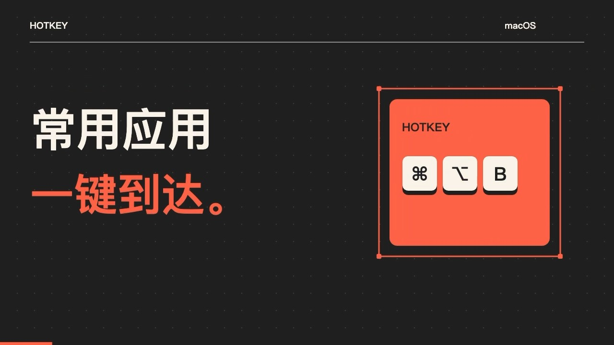

# Hotkey

[Website](https://kirktools.github.io/hotkey/) · [Latest release](https://github.com/kirktools/hotkey/releases/latest) · English · [简体中文](README.md)

A native macOS menu bar utility for global shortcuts. Launch, focus and hide apps from your keyboard, or install the official plugin to translate selected text. Configuration stays on your Mac.

[](https://kirktools.github.io/hotkey/#demo)

## Features

- Assign global shortcuts to apps. Launch when stopped, focus from the background, and hide when already in front.
- Record custom combinations; Command + Option is the suggested prefix.
- Detect internal duplicates, known system combinations and global registration failures.
- Pause shortcuts, export/import configuration and restore a backup.
- An internal app-switching plugin and an experimental external native plugin system.
- On macOS 15 or later, install the official translation plugin from **Settings → Plugins**. Reading selected text requires Accessibility permission.

## Download and use

Download the DMG from [GitHub Releases](https://github.com/kirktools/hotkey/releases) and drag Hotkey into Applications. If you download the ZIP, extract it and move Hotkey.app to Applications. Open settings from the menu bar, add an app and record a shortcut.

Requires **macOS 14+**. Current release packages target **Apple Silicon / arm64**; Intel and Universal builds are not provided. Builds use free ad-hoc signing and are **not notarized**. macOS may block the first launch; follow its per-app verification process only after checking the source. Do not disable system security protections.

## Development

Requires Swift 6 with Xcode or Command Line Tools.

```sh
make dev
make check test
make build CONFIG=release
make package
```

Hotkey Dev has a separate name, Bundle ID and data directory, an orange DEV icon badge and a DEV menu bar label. `make package` generates versioned and fixed-name archives with SHA-256 checksums, without publishing.

## Limits

Window restoration across minimized windows, fullscreen apps and Spaces follows macOS and the target app. App-specific shortcut conflicts cannot be fully enumerated. External plugins are experimental, including outstanding pipe backpressure and update identity checks; use trusted local plugins only. Screenshot support is not yet available. Use Check for Updates in the menu bar to install official app updates. External plugin packages are updated separately in Settings. The current host does not request Accessibility, Input Monitoring or Screen Recording permissions.

See [plugin development](docs/plugins.md), [signing and updates](docs/signing-and-updates.md) and [website maintenance](docs/site.md) for details. The website uses only synthetic demo data, with no tracking or external runtime dependencies.

## License

[MIT License](LICENSE).
